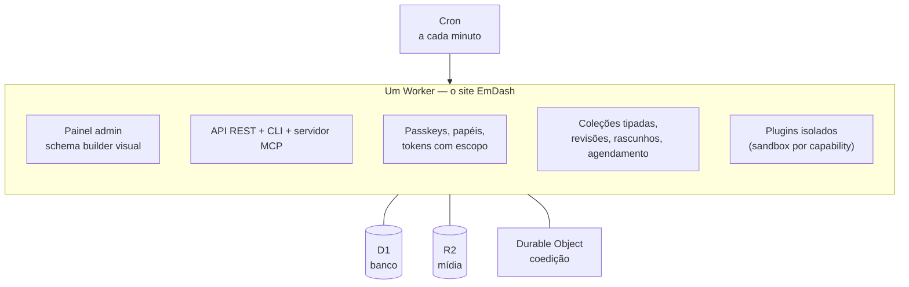
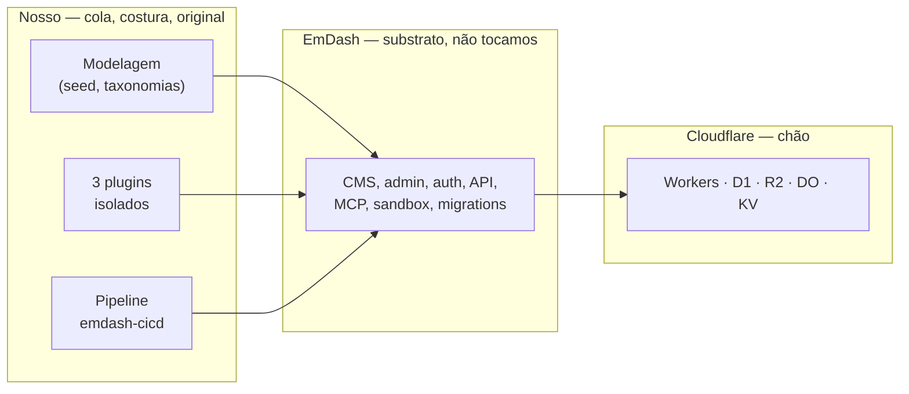

# 00 — Visão

## A ideia

Uma empresa grande tem coisas que uma pessoa sozinha normalmente não tem: um cadastro confiável de tudo o que existe (pessoas, contratos, máquinas, aplicações, processos), permissões que dizem quem pode o quê, um rastro de quem fez o quê, processos que disparam sozinhos quando algo é registrado, e um caminho controlado para pôr mudanças em produção.

Nada disso é mágica de empresa grande. É software — e esse software já existe, aberto, com licença MIT, pronto para produção. Chama-se EmDash. Ele foi escrito para ser um CMS, mas um CMS bem-feito é exatamente isto: **um sistema de registro com tipos definidos por você, permissões, histórico, API e extensões isoladas**.

Este projeto usa o EmDash como chão e constrói em cima só o que é nosso.

## O que o EmDash já entrega

Um único Worker na Cloudflare, e dentro dele:

A tabela abaixo é a mais importante deste repositório. Antes de escrever qualquer linha, procurar aqui.

### Mapa "não construir"

| Precisamos de… | O EmDash já tem | O que sobra para nós |
|---|---|---|
| Cadastrar tipos de coisa (pessoa, PJ, agente, máquina, objeto, sensor, app, processo) | Coleções de conteúdo com schema builder visual; cada coleção vira uma tabela SQL real com colunas tipadas **[doc]** | Modelar — é configuração e seed, não código |
| Identidade estável para cada registro | Todo entry tem ID estável (ULID), slug e histórico de revisões **[doc]** | Nada |
| Endereçar um registro | API REST autenticada, CLI e servidor MCP embutido **[doc]** | Nada |
| Quem pode o quê | RBAC nativo (Administrator, Editor, Author, Contributor) e tokens de API com escopos — `content:read`, `content:write`, `schema:*`, `media:*`, `transfer:*`, `mcp:tools`, `mcp:tools:<pluginId>` **[código: `packages/auth`, `packages/core/src/auth`]** | Nada |
| Quem fez o quê | Plugin oficial `audit-log`; todo save autenticado entrega ao hook um retrato do ator `{id, role}` **[código: `skills/creating-plugins/references/hooks.md`]** | Instalar o plugin |
| Registro que dispara ação externa | Plugin oficial `webhook-notifier` — POST para URLs configuradas quando conteúdo ou mídia muda **[código: `packages/plugins/webhook-notifier`]** | Instalar; usar como referência |
| Processos versionados | Revisões e rascunhos nativos de qualquer coleção | Modelar a definição como um entry |
| Execução agendada | Hook `cron` de plugin + handler `scheduled` do Worker **[código]** | Declarar |
| Vocabulário controlado | Taxonomias nativas, administráveis no painel | Criar os termos |
| Expor capacidades a agentes | Servidor MCP no core; plugins declaram MCP tools com schema Zod, permissão de rota e consentimento do administrador **[código: `skills/creating-plugins/references/api-routes.md`]** | Declarar — nunca subir outro servidor |
| Rodar código de terceiros com segurança | Sandbox de plugins: cada plugin roda num isolado próprio, só com as capabilities que declarou **[doc]** | Ligar o binding |
| Mudar o banco com segurança | `emdash migrate` com alvo conferido por fingerprint, lock no banco, forward-only **[doc]** | Orquestrar a ordem |
| Recuperar de desastre | Time Travel do D1 + procedimentos de backup documentados **[doc]** | Executar na ordem certa |
| Catálogo de extensões | Registry hospedado em `registry.emdashcms.com`, usado por padrão quando o sandbox está ligado **[doc]** | Nada |

Conclusão: nenhum requisito pede serviço novo, banco novo ou runtime novo.

## O que é nosso

Três coisas, e só três.

**1. A modelagem.** Quais coleções existem, quais campos, quais relações. É o que torna esta instalação a *sua* plataforma e não um blog. Zero código: schema builder e seed.

**2. A costura.** Três plugins pequenos, isolados, que ligam o que o EmDash já tem em algo que ele não traz pronto: um grafo de relações entre os registros, processos que disparam quando algo é cadastrado, e uma vista de governança das capacidades expostas a agentes. Detalhes em [`04-suite-de-plugins.md`](04-suite-de-plugins.md).

**3. O pipeline.** A skill `emdash-cicd`: a ordem certa de build, backup, migration, deploy e verificação, escrita como scripts para que qualquer agente ou pessoa obtenha o mesmo resultado. Detalhes em [`../skills/emdash-cicd/SKILL.md`](../skills/emdash-cicd/SKILL.md).

## Princípios

1. **Nunca infra, nunca substrato.** Se a pergunta é "como armazeno, autentico, isolo, agendo, migro ou recupero", a resposta já está no EmDash.
2. **O upstream prevalece.** Em qualquer conflito entre um texto nosso e o código ou as skills do EmDash, vale o EmDash e nós corrigimos o nosso.
3. **Nada entra por precaução.** Cada recurso Cloudflare tem um gatilho funcional explícito. O repositório do EmDash tem 26 configurações Wrangler; a instalação base usa uma.
4. **Fato se confere no código.** Documento envelhece; código não mente. Esta série marca a origem de cada afirmação.
5. **Gate é código, não opinião.** Uma fase só está aceita quando um script sai com zero ou uma skill upstream não acha problema grave.
6. **O que se aprende, se incorpora.** Todo procedimento manual descoberto numa execução vira script ou seção, com versão e changelog. O pipeline melhora a cada uso em vez de apodrecer.

## O que este projeto não é

- Não é um fork do EmDash. O código dele é dependência; aqui não há cópia.
- Não é uma plataforma multi-cliente. É uma instalação, de uma pessoa.
- Não é um motor de workflow, um banco de grafos nem um servidor MCP. É o uso disciplinado dos que já existem.
