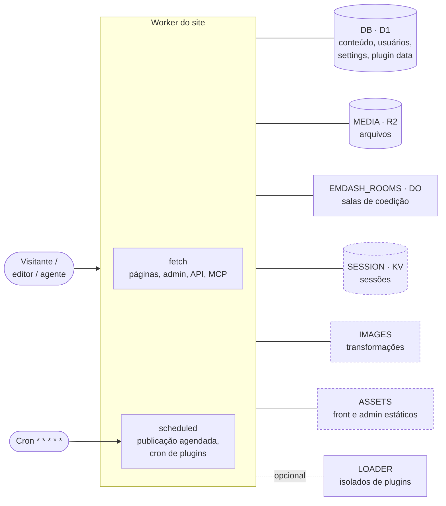
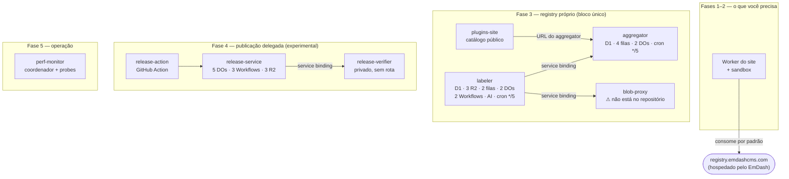
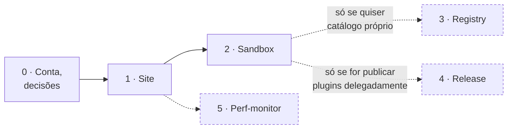

# 01 — Arquitetura

Quais são as peças, o que cada uma faz, o que acontece sem ela — e por que a ordem de instalação é a que é.

## 1. A unidade de instalação é um Worker

O EmDash não é um conjunto de serviços. Os pacotes `emdash`, `@emdash-cms/cloudflare`, o painel admin e os plugins são compilados para dentro de **um** Worker, construído a partir de **um** template. **[doc: `deployment/cloudflare.mdx`]**

O repositório do EmDash tem 26 arquivos `wrangler.jsonc` **[código — contagem na cópia de 12/11; os documentos v1 diziam 28]**. A existência de um `wrangler.jsonc` numa pasta não a torna parte da instalação. A base usa um: `templates/starter-cloudflare`.

Os templates `blog`, `marketing` e `portfolio` são alternativas ao `starter` para o *mesmo* Worker — sites com desenho pronto. Escolhe-se um. Implantar os quatro criaria quatro CMS independentes.

### O template, por inteiro

O `wrangler.jsonc` do `starter-cloudflare` declara exatamente isto **[código: `templates/starter-cloudflare/wrangler.jsonc`]**:

```jsonc
{
  "name": "my-emdash-site",
  "main": "./src/worker.ts",
  "compatibility_date": "2026-02-24",
  "compatibility_flags": ["nodejs_compat"],
  "d1_databases": [{ "binding": "DB", "database_name": "my-emdash-site" }],
  "r2_buckets":   [{ "binding": "MEDIA", "bucket_name": "my-emdash-media" }],
  "durable_objects": { "bindings": [{ "name": "EMDASH_ROOMS", "class_name": "EmDashRoom" }] },
  "exports": { "EmDashRoom": { "type": "durable-object", "storage": "sqlite" } },
  // "worker_loaders": [{ "binding": "LOADER" }],   ← sandbox; vem comentado
  "triggers": { "crons": ["* * * * *"] }
}
```

E o ponto de entrada tem doze linhas **[código: `templates/starter-cloudflare/src/worker.ts`]**: reexporta `EmDashRoom`, `EmDashRoomSite` e `PluginBridge`, e liga o handler `scheduled`. É todo o "código de infraestrutura" que existe no site — e ele vem pronto.

## 2. Cada peça e o que acontece sem ela



*Tracejado: bindings que o adapter `@astrojs/cloudflare` injeta no build. Não se declaram à mão.*

| Peça | Para que serve | Sem ela |
|---|---|---|
| `DB` (D1) | Banco canônico: conteúdo, usuários, settings, dados de plugins. O adapter `d1()` o encontra **pelo nome** — `DB`, `MEDIA` e `LOADER` precisam ser idênticos no `wrangler.jsonc` e no `astro.config.mjs` | Não há CMS |
| `MEDIA` (R2) | Arquivos de mídia, via adapter `r2()` | Sem uploads |
| `EMDASH_ROOMS` (DO, SQLite) | Uma sala de coedição por entry em edição. A coedição vem desligada, mas a doc manda manter o binding e os exports | O editor cai em modo de editor único com travas de edição — degradação silenciosa, não erro **[v1]** |
| Cron `* * * * *` + handler `scheduled` | Publica entradas agendadas e roda o cron de plugins. Precisa dos **dois**: o Cron Trigger no config e o handler exportado. Funcionar em `astro dev` não prova nada — lá o agendamento é um timer **[doc]** | Entradas agendadas nunca vão ao ar |
| `IMAGES` | Transformações de imagem. Injetado pelo adapter | Imagens saem no tamanho original, sem erro **[v1]** |
| `SESSION` (KV), `ASSETS` | Sessões do Astro; front e admin estáticos. Injetados pelo adapter | Sem login; sem páginas |
| `LOADER` + `sandboxRunner: sandbox()` | Isolados para plugins sandboxed. Exige Workers Paid. Ligar o runner também habilita o catálogo do registry hospedado **[doc: `deployment/plugin-sandbox.mdx`]** | Plugins `sandboxed: []` não carregam; instalar do catálogo falha com `SANDBOX_NOT_AVAILABLE`. **O resto do site segue normal** |
| `EMDASH_ENCRYPTION_KEY` (secret) | Cifra settings de plugin do tipo `secret` (AES-GCM). Não fica no banco **[doc: `deployment/secrets.mdx`]** | Operações com settings cifrados falham fechadas; o resto segue |

Duas notas técnicas que evitam horas perdidas:

- **`exports` e `migrations` não convivem** no mesmo `wrangler.jsonc`. O template usa `exports` para declarar `EmDashRoom`. Se um dia o projeto tiver migrations Wrangler próprias, declara-se a classe em `migrations` (`new_sqlite_classes`). Os apps `aggregator` e `labeler` usam esse segundo padrão. **[doc]**
- **Ambientes nomeados não herdam bindings.** Cada `env.<nome>` repete todos os bindings que usa, inclusive `LOADER`, e o build precisa de `CLOUDFLARE_ENV` para que o plugin do Vite e o `sandbox()` leiam o mesmo ambiente. **[doc]**

## 3. O que entra só por decisão

Regra: nada é criado porque aparece em outra config do monorepo. Cada extensão tem um gatilho funcional.

| Recurso | Entra quando… | Estado no início |
|---|---|---|
| `LOADER` + `sandbox()` | Houver qualquer plugin sandboxed, Registry ou Marketplace | Fase 2 |
| Email (`EMAIL` + `cloudflareEmail()`, ou SMTP) | Quiser magic link, convite ou recuperação. Sem provider, esses fluxos ficam **indisponíveis** — não degradam | Decisão D2 |
| KV `CACHE` (object cache) | Quiser cachear resultados de query entre requisições | Desligado |
| `cacheCloudflare()` (route cache) | Quiser cache de HTML das rotas públicas | Desligado |
| AI Search / Vectorize | Quiser busca semântica (plugin `@emdash-cms/plugin-ai-search`) | Desligado |
| Cloudflare Access | Quiser substituir a autenticação nativa | Desligado |
| Hyperdrive / PostgreSQL | Como alternativa ao D1. **Plugins sandboxed são só-D1** — não combinar **[v1]** | Não usar |
| Stream, Images como provider, R2 público | Houver requisito de vídeo, gestão de mídia pela conta Images, ou URL pública de bucket | Desligado / privado |

## 4. O ecossistema em volta (opcional, em blocos inteiros)

Além do Worker do site, o repositório do EmDash traz serviços que **a própria equipe do EmDash opera** para o ecossistema. Você não precisa de nenhum para usar plugins: o site consome o registry hospedado por padrão.



**Correção em relação à v1:** o documento original desenhava a seta do aggregator para o labeler. No código é o contrário: quem tem o service binding é o **labeler**, que chama o aggregator (`AGGREGATOR_RECONCILIATION` → `emdash-aggregator`). A ordem de instalação não muda — aggregator primeiro —, mas o motivo agora está certo. **[código: `apps/labeler/wrangler.jsonc`]**

### Inventário conferido no código

| Serviço | Recursos **[código: `wrangler.jsonc` de cada app]** |
|---|---|
| `apps/aggregator` | Worker `emdash-aggregator`; D1 `emdash-aggregator` (migrations até `0014`); filas `-records`, `-records-dlq`, `-backfill`, `-backfill-dlq`; DOs `RecordsJetstreamDO`, `LabelIngestDO`; cron `*/5`; secrets obrigatórios `ADMIN_TOKEN`, `RECONCILIATION_TOKEN` |
| `apps/labeler` | Worker `emdash-labeler`; D1 `emdash-labeler` (migrations até `0011`); R2 `-media-quarantine`, `-eval-datasets`, `-eval-artifacts`; fila `-discovery` + DLQ; DOs `LabelSubscriptionDO`, `LabelerDiscoveryDO`; Workflows `-assessment`, `-live-evaluation`; bindings `AI`, `IMAGES`, `ASSETS`; cron `*/5`; service bindings para `emdash-aggregator` e `blob-proxy` |
| `apps/plugins-site` | Worker com assets estáticos; `account_id` do upstream fixo no config; `site: https://plugins.emdashcms.com` fixo no `astro.config.mjs` |
| `apps/release-verifier` | Worker privado (`workers_dev: false`), sem bindings |
| `apps/release-service` | Worker `emdash-release-service`; 5 DOs (`IdentityDirectory…`, `Approver…`, `OAuthState…`, `ServiceControl…`, `Publisher…`); 3 Workflows; R2 `-publication-staging`, `-provenance`, `-operations`; 1 dataset Analytics Engine; secrets `OAUTH_ASSERTION_KEYSET`, `ENCRYPTION_KEYRING`; domínio e audiences do Access do upstream fixos no config. **Sem D1.** O README o chama de experimental |
| `infra/perf-monitor` | Worker `emdash-perf-coordinator`; D1 `emdash_perf`; fila `emdash-perf-deploy-events`; **6** service bindings de probe; cron `*/30`. O README fala em 4 probes. `account_id` **e** `database_id` do upstream fixos no config |

### Totais da instalação integral

| Tipo | Qtde | Detalhe |
|---|---:|---|
| Workers | 7 + probes | site, aggregator, labeler, plugins-site, release-verifier, release-service, perf-monitor (+ probes; + `blob-proxy`, que não existe no repositório) |
| D1 | 4 | site, aggregator, labeler, perf-monitor |
| R2 | 7 | 1 do site + 3 do labeler + 3 do release-service |
| KV | 1 | `SESSION` do site |
| Classes de Durable Object | 10 | 1 + 2 + 2 + 5 |
| Filas | 8 | 4 aggregator + 2 labeler + 2 perf-monitor **[v1 para a DLQ do perf-monitor]** |
| Workflows | 5 | 2 labeler + 3 release-service |
| Cron Triggers | 4 | site (`* * * * *`), aggregator (`*/5`), labeler (`*/5`), perf-monitor (`*/30`) — a v1 dizia 3 |
| GitHub Action | 1 | release-action |

### O que fica de fora, sempre

Demos (`demos/*`), a documentação do upstream (`docs/`), o painel de i18n, fixtures de teste (`e2e/fixture-cloudflare`, `fixtures/perf-site`), ferramentas de mantenedores (`infra/discord-bot`, `infra/flue-review`, `infra/do-demo`, `infra/do-solo-demo`), demos de infra (`infra/blog-demo`, `infra/cache-demo`), o playground de blocos, o harness `packages/registry-verification` e o marketplace legado (`packages/marketplace` — só interessa a quem já tem plugins legados instalados).

Vários desses configs trazem o ID de conta do upstream. Aplicá-los numa conta sua, sem limpeza, é erro. A checklist está em [`02-instalacao.md`](02-instalacao.md#limpeza-de-ids-do-upstream).

## 5. Por que a ordem é esta



**O site vem primeiro** porque é o único bloco autocontido — não depende de nenhum outro app.

**O domínio vem depois do primeiro deploy, e antes do setup.** O primeiro deploy responde num endereço `workers.dev`. Só depois de o Worker responder ali se adiciona a rota com `custom_domain: true` e se faz deploy de novo — manter o `workers.dev` vivo durante o teste separa problema de DNS de problema de aplicação. E o domínio precisa estar resolvido **antes** do assistente de setup, porque passkeys ficam presas ao hostname onde foram criadas. **[doc]**

**O setup é urgente.** A primeira pessoa a concluir o assistente vira administradora. Num endereço público, isso é uma corrida. **[doc]**

**O sandbox vem depois do site e pode entrar a qualquer momento.** Sem ele o site funciona; com ele, plugins isolados e o catálogo. É rebuild e redeploy.

**O registry próprio é opcional.** O site já consome o hospedado. Hospedar o próprio só se justifica por exigência de controlar o catálogo — e aí os três apps entram juntos, porque dependem uns dos outros. Não existe "instalar metade".

**A publicação delegada é independente.** Não depende do registry nem do site. A única ordem interna é verifier antes do service.

### Por que migration antes do deploy, e nunca duas ao mesmo tempo

Três comportamentos documentados **[doc: `deployment/core-migrations.mdx`]**:

1. **Lock no banco.** O EmDash segura um lock enquanto aplica migrations — do CLI e do modo `auto` do runtime. Uma segunda execução espera até 10 segundos; se a primeira não terminou, falha sem aplicar nada. Por isso o CI serializa por `conta + UUID do banco`, com `cancel-in-progress: false`.
2. **Só para frente.** Migrations do core não têm volta. Voltar o Worker para a versão anterior não desfaz o schema. O ponto de retorno é o bookmark do Time Travel gravado **antes**.
3. **Artefato e manifesto andam juntos.** O build escreve `.emdash/migrations.json` (versão exata, conjunto ordenado de migrations, locale, executor). Reconstruir entre a migration e o deploy quebra o par.

O modo padrão do runtime é `auto`: o Worker aplica as migrations pendentes na primeira requisição. Para sites grandes ele se recusa — acima de cerca de 5.000 linhas de conteúdo a processar, responde 503 até alguém rodar `emdash migrate`. O caminho de adoção recomendado pelo upstream é `auto` enquanto o pipeline amadurece, depois `check`, depois `manual`.

### Por que backup é parte do deploy

Cada mecanismo de recuperação deixa algo de fora **[doc: `guides/backups.mdx`, `deployment/secrets.mdx`]**:

| Mecanismo | Recupera | **Não** recupera |
|---|---|---|
| Time Travel do D1 | Conteúdo, usuários, settings, dados de plugin, registros de migration | Mídia no R2; a `EMDASH_ENCRYPTION_KEY` |
| Sync dos objetos do R2 | Mídia | Banco; chave |
| Lista de rotação da chave, em gerenciador de segredos | A capacidade de ler settings cifrados | Todo o resto |
| Export JSON do EmDash | *Nada* — não existe comando de restore. É ferramenta de inspeção | — |

Um ponto de recuperação completo são os três primeiros, criados juntos e guardados fora da conta de produção.
