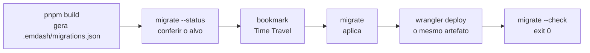

# 02 — Instalação

O roteiro, na ordem. O porquê de cada escolha está em [`01-arquitetura.md`](01-arquitetura.md); aqui ficam os passos.

**Estado em 13/11/2026:** a Fase 1 foi executada até o passo 1.3 (site criado, banco e bucket provisionados, gates verdes). O passo 1.4 em diante — o deploy — ainda não rodou. As fases 3 a 5 são plano, não relato.

## Visão geral

| Fase | O quê | Esforço | Precisa de |
|---|---|---|---|
| 0 | Conta, ferramentas, decisões | horas | Decisões D1, D2, D10 |
| **1** | **O site** — um Worker | 1–2 dias | Fase 0 |
| **2** | **Sandbox de plugins** | 2–4 horas | Workers Paid ativo |
| 3 | Registry próprio *(opcional)* | 5–10 dias | Bloqueadores B1, B2, B3 |
| 4 | Publicação delegada *(opcional, experimental)* | 5–10 dias | Bloqueador B6 |
| 5 | Perf-monitor *(opcional)* | 1–2 dias | Reconciliar 4 × 6 probes |

**As fases 0, 1 e 2 são o produto.** Com elas você tem o CMS em produção, com plugins isolados, consumindo o catálogo hospedado. As fases 3 a 5 só entram por decisão explícita — ver [`05-decisoes.md`](05-decisoes.md). Os prazos são estimativas **[v1]**.

---

## Fase 0 — Antes de instalar

### Ferramentas e conta

- Conta Cloudflare, com **Workers Paid** (obrigatório para o sandbox; uma assinatura cobre a conta toda).
- Node.js 22.16 ou mais novo, pnpm e Wrangler. **[código: `engines` do `package.json` do EmDash]**
- Um domínio ativo **na mesma conta** Cloudflare, se o site for ter endereço próprio.
- Um token de API da Cloudflare com permissão **D1 Edit**, para as migrations. Vai para secret do GitHub, nunca para arquivo.

### Nomes a fixar

O template vem com nomes de exemplo. Trocar antes de provisionar:

| No template | Trocar por |
|---|---|
| Worker `my-emdash-site` | nome de produção do Worker |
| D1 `my-emdash-site` | nome de produção do banco |
| R2 `my-emdash-media` | nome de produção do bucket |

A proposta em aberto está em [`05-decisoes.md`](05-decisoes.md).

---

## Fase 1 — O site

### 1.1 Criar o projeto

```bash
# Interativo
npm create emdash@latest

# Sem perguntas, já com o sandbox ligado
npm create emdash@latest -- <nome> --template cloudflare:starter --sandboxed-plugins --yes
```

O scaffolder aceita `--template`, `--platform`, `--pm`, `--install`/`--no-install`, `--sandboxed-plugins`/`--no-sandboxed-plugins`, `--yes` e `--force`. **[código: `packages/create-emdash/src/flags.ts`]**

O projeto criado já traz as skills `building-emdash-site`, `creating-plugins` e `emdash-cli` em `.agents/skills/`, um link de compatibilidade em `.claude/skills`, e a configuração do servidor MCP da documentação (`.mcp.json`). **[doc: `agent-skills.mdx`]**

> O scaffolder gera uma `EMDASH_ENCRYPTION_KEY` no `.env`. O `.gitignore` do template já exclui o `.env`. **Não commitar.** **[v1]**

Alternativa equivalente: copiar `templates/starter-cloudflare` do repositório do EmDash e trocar as dependências `workspace:*` e `catalog:` pelas versões publicadas. **Foi o caminho usado aqui** (decisão A13): o scaffolder baixa o template de `github.com/emdash-cms/templates`, e o ambiente em que o site foi criado não alcançava esse repositório.

Atenção a um detalhe do scaffolder: `--sandboxed-plugins` descomenta `worker_loaders` no `wrangler.jsonc`, mas não acrescenta `sandboxRunner: sandbox()` ao `astro.config.mjs`, que a doc do sandbox pede. Conferir os dois (Fase 2). **[código: `packages/create-emdash/src/utils.ts`]**

### 1.2 Provisionar o banco

`emdash migrate` nunca cria banco. Criar antes e fixar o UUID. **[doc]**

```bash
pnpm wrangler d1 create <nome-do-banco>
```

Copiar o `database_id` impresso para o binding `DB` no `wrangler.jsonc`. O bucket R2 de mídia fica privado.

> O primeiro `wrangler deploy` sem IDs cria D1, R2 e KV sozinho. Serve para um teste; não serve para produção, porque não deixa estado de infraestrutura reproduzível.

### 1.3 Conferir antes de construir

```bash
skills/emdash-cicd/scripts/preflight.sh     # ambiente, projeto, bindings
skills/emdash-cicd/scripts/gate-local.sh    # typecheck + emdash doctor
```

O `emdash doctor` confirma o par Cron Trigger + handler `scheduled`. Num projeto D1 ele reporta falha no check `database` (procura um SQLite local); isso é esperado e o gate desconsidera. **[doc]**

### 1.4 Build, migration, deploy, conferência

A ordem importa. **Não reconstruir entre a migration e o deploy.** **[doc: `deployment/core-migrations.mdx`]**



```bash
export CLOUDFLARE_ACCOUNT_ID="..."
export CLOUDFLARE_API_TOKEN="..."          # D1 Edit

pnpm build
pnpm emdash migrate --status --wrangler-config wrangler.jsonc   # ler o alvo impresso
pnpm emdash migrate          --wrangler-config wrangler.jsonc   # pede confirmação
pnpm wrangler deploy
pnpm emdash migrate --check  --wrangler-config wrangler.jsonc
```

Na prática, isso tudo é um comando: `skills/emdash-cicd/scripts/deploy.sh`, que acrescenta o backup, o lock e as guardas.

O que lembrar:

- **Em D1 o alvo é sempre explícito**: `--wrangler-config` (com `--wrangler-env` para ambiente nomeado) ou `--d1 <uuid>` com `--account-id`.
- **`emdash migrate` não lê `.env`**. As variáveis vêm do shell que o executa.
- **Não usar `wrangler d1 migrations apply` no site.** O executor do core é o `emdash migrate`.
- **Sem terminal, exige fingerprint.** O apply não-interativo precisa de `--expected-target-fingerprint` com o valor que o `--status` imprimiu depois de você conferir o alvo.
- **`--check` sai com 2** se há migrations pendentes e **3** se o banco tem registros que o build não conhece. **[doc: `reference/cli.mdx`]**

### 1.5 Domínio

Só depois de o Worker responder no endereço `workers.dev`:

```jsonc
{ "routes": [{ "pattern": "www.exemplo.com", "custom_domain": true }] }
```

Deploy de novo; conferir os dois endereços. **[doc]**

### 1.6 Setup — imediatamente

Abrir `/_emdash/admin/` e concluir o assistente. **A primeira pessoa a terminar vira administradora.**

- Passkeys só funcionam no hostname onde foram criadas. Rodar o setup no domínio final, **ou** definir `EMDASH_SITE_URL` com o domínio final antes do setup. **[doc]**
- Definir o endereço de produção por `EMDASH_SITE_URL` nas `vars`, não por `siteUrl` no `astro.config.mjs` — o `siteUrl` é embutido em todo build, inclusive previews, e quebra o login neles. **[doc]**
- Um site recém-criado nasce "em staging", escondido de buscadores, até você publicá-lo. **[doc]**

Subir a chave de criptografia:

```bash
pnpm wrangler secret put EMDASH_ENCRYPTION_KEY
```

Guardar uma cópia fora da Cloudflare. Sem ela, um banco restaurado tem settings de plugin ilegíveis.

### 1.7 A fase está aceita quando

| # | Critério | Como se verifica |
|---|---|---|
| 1.1 | Ambiente e bindings corretos | `preflight.sh` sai 0 |
| 1.2 | Gates verdes | `gate-local.sh` sai 0 |
| 1.3 | Migrations aplicadas | `emdash migrate --check` sai 0 |
| 1.4 | Site no ar | `postdeploy.sh --url <url>` sai 0 |
| 1.5 | Setup feito no domínio final | Login por passkey funciona ali |
| 1.6 | Agendamento funciona | Agendar um post para daqui a 2 minutos; ele vai ao ar |
| 1.7 | Ponto de retorno registrado | Existe `backups/<ts>/time-travel.json` |
| 1.8 | Revisão sem achado grave | Skill `adversarial-reviewer` sobre o diff de configuração |

---

## Fase 2 — Sandbox

Se o projeto foi criado com `--sandboxed-plugins`, esta fase já veio feita. Caso contrário **[doc: `deployment/plugin-sandbox.mdx`]**:

1. `wrangler.jsonc` — descomentar:

   ```jsonc
   "worker_loaders": [{ "binding": "LOADER" }]
   ```

2. `astro.config.mjs`:

   ```js
   import { d1, r2, sandbox } from "@emdash-cms/cloudflare";

   emdash({
     database: d1({ binding: "DB", session: "auto", coalesce: true }),
     storage: r2({ binding: "MEDIA" }),
     sandboxRunner: sandbox(),
   });
   ```

3. Conferir que `src/worker.ts` exporta `PluginBridge` (o template já exporta).
4. Rebuild e redeploy pelo pipeline.

O `sandbox()` confere o `wrangler.jsonc` no build. Sem o binding, ele não falha: desliga o runner e avisa no log. Por isso o `preflight.sh` olha o binding antes.

**Aceita quando:** `preflight.sh` mostra `LOADER` como PASS; um plugin do catálogo instala pelo admin sem `SANDBOX_NOT_AVAILABLE`; `postdeploy.sh` sai 0.

Em seguida, instalar do catálogo os dois plugins oficiais que a suíte usa como base: `audit-log` e `webhook-notifier`.

---

## Fase 3 — Registry próprio *(opcional)*

Só se você decidir controlar o catálogo (decisão D4). Os três apps entram juntos.

**Bloqueadores, todos fora do repositório:**

| # | Bloqueador | Evidência |
|---|---|---|
| B1 | O labeler tem service binding para um Worker `blob-proxy` que **não existe** no repositório | **[código: `apps/labeler/wrangler.jsonc`]** |
| B2 | A origem do CDN está fixa em `https://cdn.em-da.sh` | **[código: `packages/registry-lexicons/src/index.ts`]** |
| B3 | Dois hostnames para o aggregator: `registry.emdashcms.com` no loader e `api.emdashcms.com` no runbook do labeler | **[código: `packages/registry-loader/src/index.ts`, `apps/labeler/docs/runbooks.md`]** |

**Ordem:** aggregator → labeler → plugins-site.

Estes apps aplicam migrations com o Wrangler (`pnpm db:migrate` = `wrangler d1 migrations apply … --remote`), **diferente** do site, que usa `emdash migrate`. **[código: `package.json` de cada app]**

**`apps/aggregator`**
1. Provisionar D1 e as 4 filas; fixar o `database_id` (o config o omite de propósito).
2. Definir a rota de produção — ela não está no `wrangler.jsonc`.
3. `pnpm db:migrate`, depois `pnpm deploy`.
4. `wrangler secret put ADMIN_TOKEN` e `RECONCILIATION_TOKEN`. O config os declara como obrigatórios.
5. Se usar relays próprios, sobrescrever `JETSTREAM_URL` e `RELAY_URL`. **[v1]**

**`apps/labeler`**
1. Provisionar D1, os 3 buckets e a fila com sua DLQ **antes** das migrations.
2. Resolver B1.
3. Configurar Access e os secrets obrigatórios do config (entre eles o par `LABEL_SIGNING_PRIVATE_KEY` / `LABEL_SIGNING_PUBLIC_KEY`; a lista completa está no bloco `secrets.required`).
4. `pnpm db:migrate`, depois `pnpm deploy`.

**`apps/plugins-site`**
1. Remover o `account_id` do upstream do `wrangler.jsonc`.
2. Trocar `site:` no `astro.config.mjs`.
3. Apontar `src/lib/registry.ts` para o aggregator próprio — hoje ele usa `DEFAULT_REGISTRY_URL`.
4. `pnpm deploy`.

**Aceita quando:** um plugin de teste, publicado numa conta AT Protocol sua, é ingerido pelo aggregator, moderado pelo labeler e aparece no plugins-site — e nenhum ID ou domínio do upstream sobra nos configs.

---

## Fase 4 — Publicação delegada *(opcional, experimental)*

O README do `release-service` o declara experimental. **[código]**

**Bloqueador B6:** o verifier não aceita raiz Sigstore privada; repositórios GitHub internos ou privados falham na verificação. **[v1]**

**Ordem:** `release-verifier` → `release-service` → `release-action`.

1. **Verifier:** `pnpm deploy`. É privado, sem rota; só é chamado por service binding.
2. **Service:** trocar `ACCESS_TEAM_DOMAIN` e os três `ACCESS_*_AUD` pelos da sua conta; provisionar os 3 buckets; `secret put` de `OAUTH_ASSERTION_KEYSET` e `ENCRYPTION_KEYRING`; configurar a confiança OIDC do GitHub; `pnpm deploy`.
3. **Action:** adicionar aos workflows do publicador, com `id-token: write`.

**Aceita quando:** uma release de teste passa de ponta a ponta com proveniência verificada, e o risco de "experimental" está aceito por escrito em `05-decisoes.md`.

---

## Fase 5 — Perf-monitor *(opcional)*

`infra/perf-monitor`: um coordenador e Workers de probe em regiões diferentes.

- O config declara **6** probes (`use`, `euw`, `ape`, `aps`, `sae`, `oce`); o README descreve **4**. Reconciliar antes. **[código]**
- O config traz `account_id` **e** `database_id` do upstream. Trocar os dois.
- `pnpm deploy` constrói, publica os probes e depois o coordenador.

---

## Limpeza de IDs do upstream

Regra: nenhum ID de conta, UUID de banco, audience do Access ou domínio do upstream entra na sua conta.

O ID de conta do upstream é `1f74638c495bc9f0330ce5c8e64c1b6b`. Lista conferida por busca em todos os `wrangler.jsonc` **[código]** — mais longa que a da v1:

| Arquivo | O que trocar | Usado na instalação? |
|---|---|---|
| `apps/plugins-site/wrangler.jsonc` | `account_id` | Fase 3 |
| `apps/plugins-site/astro.config.mjs` | `site: https://plugins.emdashcms.com` | Fase 3 |
| `apps/release-service/wrangler.jsonc` | `ACCESS_TEAM_DOMAIN`, `ACCESS_VIEWER_AUD`, `ACCESS_REVIEWER_AUD`, `ACCESS_ADMIN_AUD` | Fase 4 |
| `infra/perf-monitor/wrangler.jsonc` | `account_id` **e** `database_id` *(ausente da v1)* | Fase 5 |
| `packages/registry-lexicons/src/index.ts` | `REGISTRY_CUMULUS_ORIGIN` (B2) | Fase 3 |
| `apps/labeler/docs/runbooks.md` | hostname do aggregator (B3) | Fase 3 |
| `packages/marketplace/wrangler.jsonc` | `database_id` | Não — legado |
| `infra/blog-demo`, `infra/cache-demo` | `account_id` e o mesmo `database_id` nos dois | Não — não aplicar |
| `infra/discord-bot`, `infra/flue-review`, `infra/do-demo`, `infra/do-solo-demo`, `packages/blocks/playground` | `account_id` | Não — não aplicar |

---

## Secrets por app

| App | Secrets |
|---|---|
| Site | `EMDASH_ENCRYPTION_KEY` |
| aggregator | `ADMIN_TOKEN`, `RECONCILIATION_TOKEN` |
| labeler | Os de `secrets.required` no config + credenciais do Access |
| release-service | `OAUTH_ASSERTION_KEYSET`, `ENCRYPTION_KEYRING` + Access / OIDC |

Só nomes nos arquivos. Valores em secret do Worker, secret do GitHub ou gerenciador de segredos.

---

## O deploy no GitHub Actions

Este repositório tem dois workflows, e os dois chamam os scripts da skill:

- [`ci.yml`](../.github/workflows/ci.yml) — em todo push: preflight, build, gates, ensaio de deploy.
- [`deploy.yml`](../.github/workflows/deploy.yml) — manual, com duas ações: `status` (só inspeciona o alvo e mostra o fingerprint) e `deploy` (pipeline completo, com backup antes da migration).

**Para o primeiro deploy**, no GitHub, em *Settings → Secrets and variables → Actions*:

| Tipo | Nome | Valor |
|---|---|---|
| Secret | `CLOUDFLARE_API_TOKEN` | Token com Workers Scripts Edit, D1 Edit, Workers R2 Storage Edit, Workers KV Storage Edit |
| Variável | `CLOUDFLARE_ACCOUNT_ID` | ID da conta |
| Variável | `EMDASH_TARGET_FINGERPRINT` | O que a ação `status` imprimir, **depois de você conferir conta e banco** |
| Variável | `EMDASH_DEPLOY_URL` | Opcional. Sem ela, o pós-deploy verifica a URL `workers.dev` que o deploy imprimir |
| Secret | `EMDASH_ENCRYPTION_KEY` | Opcional no primeiro deploy |

Depois: *Actions → Deploy → Run workflow* → `status`; conferir; gravar o fingerprint; `deploy`.

Para referência, o workflow oficial do EmDash, do qual o nosso deriva **[doc: `deployment/core-migrations.mdx`]** — ele usa as variáveis `CLOUDFLARE_ACCOUNT_ID`, `D1_DATABASE_ID` e `EMDASH_TARGET_FINGERPRINT`:

```yaml
name: Deploy
on:
  workflow_dispatch:

concurrency:
  group: emdash-migrations-${{ vars.CLOUDFLARE_ACCOUNT_ID }}-${{ vars.D1_DATABASE_ID }}
  cancel-in-progress: false

jobs:
  deploy:
    runs-on: ubuntu-latest
    steps:
      - uses: actions/checkout@v4
      - uses: pnpm/action-setup@v4
      - uses: actions/setup-node@v4
        with:
          node-version: 22
          cache: pnpm
      - run: pnpm install --frozen-lockfile
      - run: pnpm build
      - name: Inspect EmDash migration target
        env:
          CLOUDFLARE_API_TOKEN: ${{ secrets.CLOUDFLARE_API_TOKEN }}
        run: |
          pnpm emdash migrate --status --json \
            --account-id "${{ vars.CLOUDFLARE_ACCOUNT_ID }}" \
            --d1 "${{ vars.D1_DATABASE_ID }}"
      - name: Apply EmDash migrations
        env:
          CLOUDFLARE_API_TOKEN: ${{ secrets.CLOUDFLARE_API_TOKEN }}
          EMDASH_TARGET_FINGERPRINT: ${{ vars.EMDASH_TARGET_FINGERPRINT }}
        run: |
          pnpm emdash migrate \
            --account-id "${{ vars.CLOUDFLARE_ACCOUNT_ID }}" \
            --d1 "${{ vars.D1_DATABASE_ID }}" \
            --expected-target-fingerprint "$EMDASH_TARGET_FINGERPRINT"
      - run: pnpm wrangler deploy
      - name: Check EmDash migrations
        env:
          CLOUDFLARE_API_TOKEN: ${{ secrets.CLOUDFLARE_API_TOKEN }}
        run: |
          pnpm emdash migrate --check \
            --account-id "${{ vars.CLOUDFLARE_ACCOUNT_ID }}" \
            --d1 "${{ vars.D1_DATABASE_ID }}"
```

Dois cuidados:

- O `wrangler deploy` do workflow também precisa do token no ambiente. O exemplo upstream não o mostra nesse passo; ao adotar, conferir. **[nosso — observação de leitura, não testada]**
- **Atualizar `EMDASH_TARGET_FINGERPRINT` só depois de conferir o alvo localmente.** O fingerprint não é segredo, mas trocá-lo sem olhar remove a proteção contra migrar o banco errado.

O workflow oficial não inclui o bookmark do Time Travel. O nosso inclui, porque roda o `deploy.sh` da skill, e guarda o bookmark como artefato do job por 90 dias.

---

## Staging e previews

Duas formas, com consequências diferentes **[doc: `deployment/cloudflare.mdx`]**:

| | Worker Previews (`wrangler preview`) | Ambiente nomeado (`env.preview`) |
|---|---|---|
| Recursos | Compartilham o que está no bloco `previews` — por padrão, **o mesmo banco** entre branches | Próprios; nada é herdado, repete-se cada binding |
| Migrations | A primeira requisição aplica as pendentes — um branch que atualiza o EmDash migra o banco dos outros previews | Idem, mas no banco do ambiente |
| Cron | **Não roda** — nada agendado publica | Roda |
| Setup | URL pública; o primeiro visitante que concluir vira admin | Idem |

A escolha é a decisão D10. A skill ainda não suporta ambiente nomeado nos scripts — está registrado como lacuna no changelog dela.
