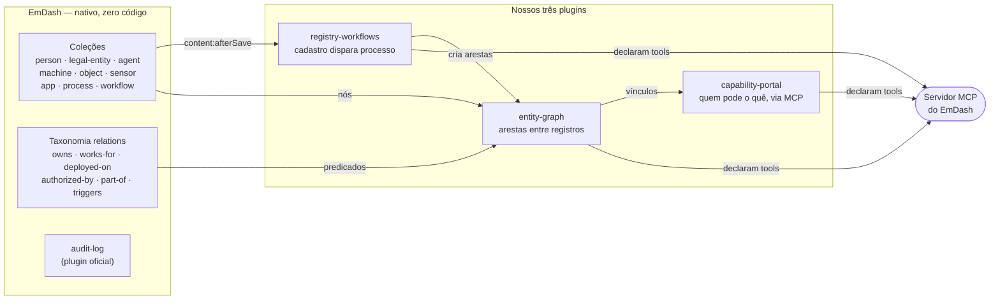
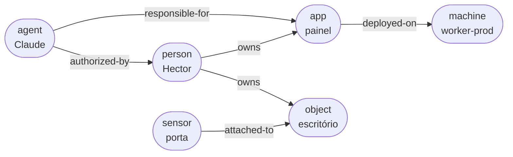
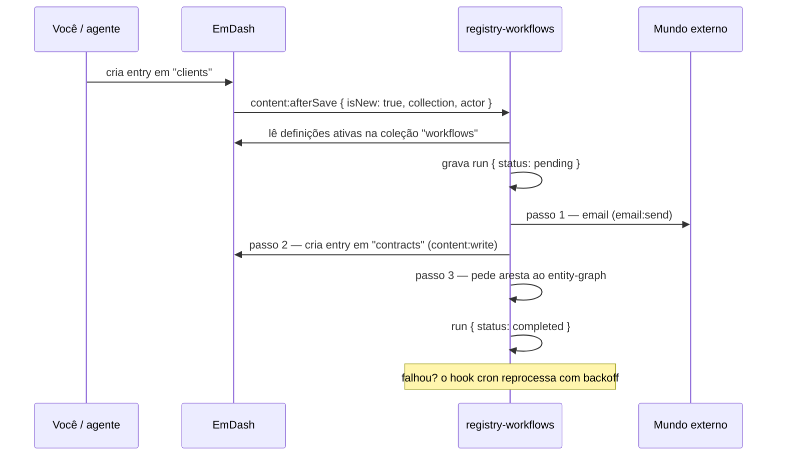

# 04 — A suíte de plugins

O que vamos escrever de original: três plugins pequenos e isolados, que ligam o que o EmDash já tem em algo que ele não traz pronto.

**Estado:** estudo. Nenhum plugin foi escrito. O formato foi conferido contra a skill upstream `creating-plugins`; o desenho ainda não foi testado.

## 1. A ideia em uma imagem

Você cadastra uma coisa. O cadastro tem identidade, tem dono, se liga a outras coisas, e pode pôr um processo em movimento.



Tudo roda dentro do Worker do site, como plugins sandboxed. Nenhum serviço novo, nenhum banco novo.

## 2. O grafo: um só, sobre o armazenamento que já existe

**Decisão tomada** (ver [`05-decisoes.md`](05-decisoes.md)): um grafo lógico único. Não um banco de grafos; não um grafo por tipo de entidade.

**Por que não um banco de grafos.** O EmDash roda sobre D1. Um serviço externo de grafos seria exatamente o que a regra da casa proíbe: infra. E ficaria fora de tudo o que governa o resto — admin, CLI, MCP, permissões, auditoria. Para o tamanho deste domínio (milhares a poucos milhões de registros), consultas indexadas de um ou dois saltos resolvem.

**Por que um só.** As relações que importam atravessam tipos: *pessoa trabalha-para empresa*, *app implantado-em máquina*, *sensor acoplado-a objeto*, *agente autorizado-por pessoa*. Grafos separados quebrariam justamente essas consultas. Um padrão único de aresta dá uma regra única de permissão e um lugar único para auditar.

**Se um dia separar fizer sentido** — telemetria efêmera em volume alto ao lado de cadastro legal imutável, por exemplo —, a separação é por coleção e por índice, não por banco. O modelo já permite.

### O modelo

```text
NÓ        = um entry de uma coleção comum (criada no schema builder ou por seed)
ARESTA    = um registro na storage "edges" do plugin entity-graph:
            { fromId, fromType, predicate, toId, toType, since, until?, actor, note }
PREDICADO = um termo da taxonomia "relations"
```



Uma restrição da plataforma que molda o desenho: um plugin com `taxonomies:write` pode criar termos e atribuí-los a entries, mas **não pode** criar nem alterar a *definição* de uma taxonomia. A taxonomia `relations` nasce no admin ou no seed; o plugin só lê. **[código: `skills/creating-plugins/references/taxonomies-and-redirects.md`]**

## 3. Identidade: quatro camadas que já existem

| Camada | Mecanismo do EmDash | Exemplo |
|---|---|---|
| Quem é | ID estável do entry + slug | um entry em `apps` |
| Como se alcança | API, CLI ou MCP | `content get apps <id>` |
| O que pode fazer | Token de API com escopos, emitido por um administrador | um sensor com token só de `content:read` |
| Pelo que responde | Arestas `responsible-for` e `authorized-by` + o retrato do ator em cada save + `audit-log` | "deploy do app X feito pelo agente Y às 14h03" |

**Regra de costura:** o plugin nunca guarda o segredo de um token. Quem detém tokens é o EmDash. O plugin registra só o vínculo *este registro ↔ este token, com estes escopos*.

Uma limitação a conhecer: o retrato do ator entregue ao hook é `{ id, role }` e **não diz por onde veio o save** — REST, edição visual e MCP são indistinguíveis ali. Saves internos podem vir sem ator. **[código: `references/hooks.md`]**

## 4. Cadastro que dispara processo

Sem motor de workflow próprio. Definição é conteúdo; instância é storage; gatilho é hook.



O evento traz `isNew`, `collection`, `content` e, em saves autenticados, `actor`. Em atualizações, `content` traz **só os campos enviados**. **[código: `references/hooks.md`]**

| Você quer | Definição (um entry em `workflows`) | Passos |
|---|---|---|
| Cadastrar cliente dispara email | ao criar em `clients` | email ao cliente + email a você |
| Cadastrar app dispara deploy | ao criar em `apps` | requisição ao pipeline de CI |
| Cadastro estabelece contrato | ao criar em `clients` | cria entry em `contracts` + aresta `client has-contract contract` |

Como cada definição é um entry comum, ela ganha de graça revisões, rascunho e histórico.

### Um cuidado que o desenho original não tinha

A storage de plugin oferece escrita condicional (compare-and-swap), mas a própria doc avisa: uma resposta perdida deixa o resultado desconhecido, e **CAS não é mecanismo de exatamente-uma-vez para efeitos externos**. **[código: `references/storage.md`]**

Na prática: um passo que manda email ou chama um webhook **pode rodar duas vezes** num reprocesso. O plugin deve:

- gravar a intenção antes de executar o passo, e o resultado depois;
- mandar uma chave de idempotência em toda chamada externa (o `id` do run + o índice do passo);
- deixar passos sem idempotência possível (email) marcados como "no máximo uma tentativa automática", com retry só manual.

### Limites aceitos de propósito

Passos em sequência, sem paralelismo, sem ramificação. Se um dia precisar de mais, o passo é uma chamada a um orquestrador de fora. O plugin continua pequeno e auditável.

## 5. O portal de capacidades

**Decisão tomada:** não subir um segundo servidor MCP.

O EmDash já tem um servidor MCP no core. Um plugin expõe uma rota privada como tool, com nome `<pluginId>__<tool>`. A plataforma já cuida de tudo isto **[código: `references/api-routes.md`]**:

- a tool precisa de schema Zod de entrada e de permissão de rota explícita;
- operações difíceis de desfazer são marcadas `destructive: true`;
- a instalação mostra as tools exatas ao administrador, para consentimento;
- depois de instalar, o administrador **habilita separadamente** as tools MCP do plugin;
- quem chama precisa da permissão da rota **e** do escopo `mcp:tools` ou `mcp:tools:<pluginId>`;
- acrescentar uma tool, ou tornar pública uma rota, exige nova aprovação.

O "portal" é uma página no admin que mostra, num lugar só, o que está exposto a agentes: plugin, tool, escopo, consentido ou não, ativo ou não. É uma vista de governança, não um endpoint.

## 6. Os três plugins

Todos sandboxed, criados com `pnpm dlx @emdash-cms/plugin-cli init <nome>`, que gera manifesto, testes e a skill `creating-plugins` dentro do projeto do plugin. **[código: `skills/creating-plugins/SKILL.md`]**

As capabilities abaixo usam os nomes reais do manifesto **[código: `packages/plugin-types`]**.

### `entity-graph`

| | |
|---|---|
| Storage | `edges`, com índices `fromId`, `toId`, `predicate`, `[fromType, predicate]`, `[toType, predicate]` |
| Hooks | `content:afterDelete` → remove arestas órfãs |
| Rotas privadas | consultar vizinhança (com limite de profundidade), criar aresta, remover aresta |
| MCP tools | `graphNeighbors`; `linkEntities`; `unlinkEntities` (`destructive: true`) |
| Capabilities | `content:read`, `taxonomies:read` |
| Admin | página "Grafo": busca um registro, mostra a vizinhança; widget de contagens |
| Estimativa | 1–2 semanas **[v1]** |

### `registry-workflows`

| | |
|---|---|
| Storage | `runs` (índices `workflowId`, `entityId`, `status`, `createdAt`); `steps` (índices `runId`, `status`) |
| Hooks | `content:afterSave` (com `isNew`); `cron` (reprocesso) |
| Rotas privadas | disparar manualmente, listar runs, repetir um run |
| MCP tools | `triggerWorkflow`, `getRunStatus` |
| Capabilities | `content:read`, `content:write`, `email:send`, `network:request` com `allowedHosts` |
| Admin | página "Runs": estado, tentativas, erro |
| Estimativa | 2–3 semanas **[v1]** |

Sobre a rede: `network:request` restringe as chamadas aos `allowedHosts` declarados no manifesto. O `webhook-notifier` oficial usa `network:request:unrestricted`, porque as URLs são fornecidas pelo usuário em runtime e não há lista a fixar na publicação. **[código: `packages/plugins/webhook-notifier/emdash-plugin.jsonc`]** Para nós, que sabemos de antemão para onde os passos chamam, a versão restrita é a certa — menos autoridade, mesmo resultado. Mudar a lista de hosts exige nova aprovação do administrador; é o preço, e é bom que seja.

### `capability-portal`

| | |
|---|---|
| Storage | `credentials` (índice `entityId`; índice único `tokenId`) |
| Hooks | `content:afterDelete` → marca o vínculo como revogado (a revogação real do token é do EmDash) |
| Rota + MCP tool | `whois`: dado um registro, devolve tipo, vínculos, credenciais e responsabilidades |
| Capabilities | `users:read` |
| Admin | página "Portal": tabela de capacidades expostas + busca whois |
| Estimativa | 1 semana **[v1]** |

Ponto em aberto: o `whois` precisa das arestas do `entity-graph`. Como um plugin sandboxed lê dados de outro ainda não foi estudado — pode ser por rota, pode pedir outro desenho. Resolver lendo `references/sandbox-boundaries.md` antes de começar este plugin.

## 7. O padrão da casa para plugins

É o formato do EmDash, mais poucas convenções nossas.

1. **O manifesto `emdash-plugin.jsonc` é o contrato de confiança.** Toda capability, rota pública, storage e MCP tool está lá. Nada fora do declarado funciona.
2. **Sandboxed por padrão.** Nativo só com justificativa escrita — perde o catálogo e o consentimento.
3. **A menor autoridade que resolve.** `network:request` com lista antes de `:unrestricted`; `:read` antes de `:write`.
4. **Storage declarada, com índices explícitos.** Coleção não declarada é rejeitada pela ponte do sandbox. Campos em `uniqueIndexes` já são consultáveis; não repetir em `indexes`. **[código: `references/storage.md`]**
5. **Toda rota privada com permissão explícita.**
6. **Toda MCP tool com schema Zod**; o que não se desfaz, `destructive: true`.
7. **Efeito externo com chave de idempotência.**
8. **Testes nos dois níveis:** `createPluginTestHost()` e `createPluginRuntimeTestHost()`. O host de teste **não** exercita autorização de rota, cache de resposta, registro de MCP nem consentimento — isso se confere no site rodando. **[código: `references/api-routes.md`]**
9. **Revisão adversarial em toda release**, pela skill upstream.
10. **Versão semântica e CHANGELOG por plugin.**

Plugins de primeira parte e o ferramental de plugins ainda estão em `0.x` no EmDash e podem mudar entre versões menores. **[código: `README.md` do EmDash]** Contar com retrabalho pequeno a cada upgrade.

## 8. Sequência

| Passo | Trabalho | Código nosso |
|---|---|---|
| 1 | Fases 1–2 da instalação | — |
| 2 | Instalar `audit-log` e `webhook-notifier` do catálogo | Zero |
| 3 | Criar as coleções de entidade e a taxonomia `relations`, por schema builder ou seed | Zero |
| 4 | `entity-graph` | Pequeno |
| 5 | `registry-workflows` | Médio |
| 6 | `capability-portal` | Pequeno |

Antes de escrever cada um: procurar no catálogo público (`plugins.emdashcms.com`) se já existe algo parecido.

### A suíte está aceita quando

- Cadastrar um cliente gera o email, o entry em `contracts` e a aresta — e o run termina `completed`.
- Cadastrar um app entrega a requisição ao pipeline, para um host que está na lista.
- Repetir um run **não** reenvia o email.
- `whois` por MCP, com token de escopo `mcp:tools:capability-portal`, devolve identidade, vínculos e responsabilidades.
- Remover uma aresta por MCP aparece no `audit-log`, com ator.
- Cada plugin passa `validate`, `typecheck`, `test` e `build`, e a revisão adversarial sem achado crítico ou alto.

## 9. Fontes

No repositório do EmDash:

- `skills/creating-plugins/SKILL.md` e `references/` — `hooks.md`, `storage.md`, `api-routes.md`, `admin-ui.md`, `block-kit.md`, `sandbox-boundaries.md`, `content.md`, `taxonomies-and-redirects.md`, `publishing.md`
- `packages/plugins/webhook-notifier`, `audit-log`, `forms`, `marketplace-test`
- `docs/src/content/docs/plugins/`
