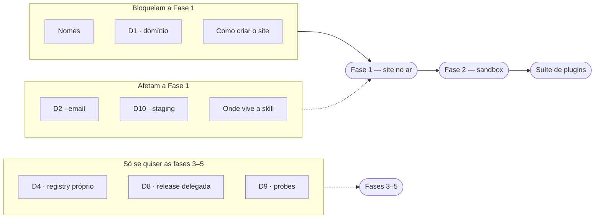

# 05 — Decisões

O registro do que está decidido, do que espera decisão e do que cada pendência bloqueia.

Quem decide é o Hector. Uma decisão registrada aqui não se reabre sem fato novo; quando se reabre, a anterior fica riscada, não apagada.

## Painel

## Decididas

| # | Decisão | Quando | Por quê, em uma linha |
|---|---|---|---|
| A1 | A unidade de instalação é **um Worker**, do template `starter-cloudflare` | 13/11/2026 | É como o EmDash é feito; o resto do monorepo não é a instalação |
| A2 | **Um grafo lógico único**, sobre storage de plugin; predicados na taxonomia `relations` | 13/11/2026 | As relações que importam atravessam tipos; banco de grafos seria infra |
| A3 | **Workflows sem motor próprio:** definição é entry, gatilho é `content:afterSave`, instância é storage, reprocesso é hook `cron` | 13/11/2026 | Tudo isso o EmDash já tem |
| A4 | **Nenhum segundo servidor MCP.** O portal é uma página de governança no admin | 13/11/2026 | O core já tem o servidor; plugins declaram tools |
| A5 | A suíte são **três plugins sandboxed**: `entity-graph`, `registry-workflows`, `capability-portal` | 13/11/2026 | — |
| A6 | A skill `emdash-cicd` é **viva**: toda mudança pede bump de versão e changelog | 13/11/2026 | Senão ela apodrece no primeiro uso |
| A7 | **Código nosso é cola, costura ou algo original — nunca infra, nunca substrato** | 13/11/2026 (reafirmada) | A regra da casa |
| A8 | **Workers Paid e R2 ativos na conta** | 13/11/2026 | Informado pelo Hector; atende o pré-requisito do sandbox |
| A9 | A documentação é **versionada no GitHub**, com os originais preservados em `docs/origem/` | 13/11/2026 | Pedido do Hector |

## Pendentes — o que eu preciso de você

Em ordem de urgência. Cada uma traz a recomendação e o que ela destrava.

### Bloqueiam a Fase 1

**Nomes dos recursos.**
Proposta: Worker `hector-ai-platform`, banco D1 `hector-ai-platform`, bucket R2 `hector-ai-platform-media`. Trocar depois de provisionar é trabalhoso; trocar antes é uma linha.

**D1 — Domínio do site.**
Qual endereço? Precisa estar ativo na mesma conta Cloudflare. Tem de estar resolvido **antes** do assistente de setup, por causa das passkeys. Sem domínio ainda, dá para começar no `workers.dev` definindo `EMDASH_SITE_URL` desde o início — mas aí é preciso saber qual será o domínio.

**Como criar o site.**
(a) Rodar o scaffolder oficial, `npm create emdash@latest`; ou (b) copiar `templates/starter-cloudflare` do repositório do EmDash e fixar as versões publicadas.
Recomendação: (a), por ser o caminho oficial e já trazer skills e configuração de MCP. Em 13/11 a trava de segurança do ambiente bloqueou a execução do scaffolder; se bloquear de novo, (b) dá o mesmo resultado com mais passos manuais.

### Afetam a Fase 1

**D2 — Email.**
Sem provider, magic link, convite e recuperação de conta ficam **indisponíveis**. Com passkey você entra do mesmo jeito. Opções: Cloudflare Email Sending (pede domínio remetente verificado), SMTP externo, ou nada por enquanto.
Recomendação: nada no primeiro deploy; Cloudflare Email Sending logo depois — o plugin `registry-workflows` vai precisar de `email:send`. Atenção: sem email, a única porta de entrada é a passkey; perdê-la sem ter outra cadastrada tranca o admin.

**D3 — Sandbox já no primeiro deploy?**
O pré-requisito (Workers Paid) está atendido — decisão A8.
Recomendação: sim, criando o projeto com `--sandboxed-plugins`. Falta só a sua confirmação.

**D10 — Staging.**
Ambiente nomeado com D1 e R2 próprios, ou Worker Previews? A diferença está em [`02-instalacao.md`](02-instalacao.md#staging-e-previews).
Recomendação: ambiente nomeado `preview`, com recursos próprios. É onde o primeiro run real do pipeline deve acontecer — o risco R10 pede um alvo descartável. A skill precisa ganhar suporte a `--wrangler-env` antes; é uma lacuna registrada.

**Onde vive a nossa skill.**
O scaffolder cria `.agents/skills/` com as skills upstream e um link `.claude/skills` apontando para lá. Hoje a nossa está em `skills/emdash-cicd/`, com um link próprio em `.claude/skills/emdash-cicd`. Os dois arranjos vão colidir quando o site for criado na raiz.
Recomendação: manter `skills/emdash-cicd/` como casa (o `upgrade-emdash` mexe em `.agents/skills/`, e não quero a nossa skill no caminho dele) e, ao criar o site, acrescentar um link para ela dentro de `.agents/skills/`. Conferir antes como o `upgrade-emdash` trata skills que não são dele.

**Site na raiz ou em subpasta.**
Recomendação: na raiz — é o que o workflow oficial de deploy espera — com os plugins em `plugins/`.

### Só se você quiser as fases 3 a 5

| ID | Decisão | Recomendação |
|---|---|---|
| D4 | Hospedar o próprio registry? | Não. Consumir o hospedado. Só muda se você quiser um catálogo privado |
| D5 | Hostname do aggregator (bloqueador B3) | Só se D4 = sim |
| D6 | Construir o `blob-proxy` (bloqueador B1) | Só se D4 = sim. **Atenção:** isso seria escrever infra — contraria A7. Prefiro esperar o upstream publicar |
| D7 | CDN próprio ou do upstream (bloqueador B2) | Só se D4 = sim |
| D8 | Publicação delegada (bloqueador B6) | Não agora. É experimental e serve a quem publica plugins para terceiros |
| D9 | Perf-monitor: 4 ou 6 probes | Só se quiser o perf-monitor |

## Bloqueadores externos

Coisas que não dependem de decisão sua, e sim de algo que falta fora deste repositório.

| # | O que falta | Trava |
|---|---|---|
| B1 | Worker `blob-proxy`, referenciado pelo labeler, não existe no repositório do EmDash | Fase 3 |
| B2 | Origem do CDN fixa em `https://cdn.em-da.sh` | Fase 3 |
| B3 | Dois hostnames para o aggregator no código | Fase 3 |
| B6 | Verifier não aceita raiz Sigstore privada | Fase 4 |

Os antigos B4 (IDs do upstream) e B5 (domínio) deixaram de ser bloqueadores: B4 virou a checklist de limpeza em `02-instalacao.md`; B5 é a decisão D1.

## Perguntas técnicas em aberto

Não são decisões suas — são coisas que eu ainda não sei e preciso estudar antes de afirmar.

1. Como um plugin sandboxed lê dados de outro (o `whois` do `capability-portal` precisa das arestas do `entity-graph`).
2. Como o `upgrade-emdash` trata skills em `.agents/skills/` que não são dele.
3. Se o `wrangler d1 time-travel info --json`, usado pelo `backup-point.sh`, devolve o bookmark no campo que o script procura. Só um run real responde.
4. Se o passo `wrangler deploy` do workflow oficial precisa do token no ambiente, como parece.

## Como registrar uma decisão nova

1. Mover a linha de "Pendentes" para "Decididas", com data e o porquê em uma linha.
2. Se ela muda a arquitetura, atualizar o documento afetado no mesmo commit.
3. Registrar em [`CHANGELOG.md`](CHANGELOG.md).
