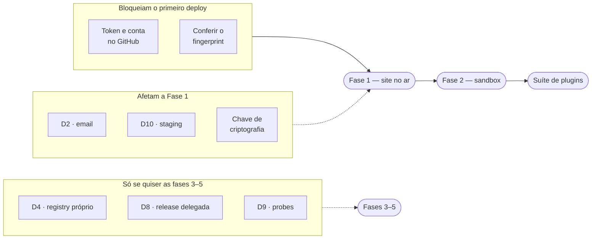

# 05 — Decisões

O registro do que está decidido, do que espera decisão e do que cada pendência bloqueia.

Quem decide é o Hector. Uma decisão registrada aqui não se reabre sem fato novo; quando se reabre, a anterior fica riscada, não apagada.

## Painel

## Decididas

| # | Decisão | Quando | Por quê, em uma linha |
|---|---|---|---|
| A1 | A unidade de instalação é **um Worker**, do template `starter-cloudflare` | 13/11/2026 | É como o EmDash é feito; o resto do monorepo não é a instalação |
| A2 | **Um grafo lógico único**, sobre storage de plugin; predicados na taxonomia `relations` | 13/11/2026 | As relações que importam atravessam tipos; banco de grafos seria infra |
| A3 | **Workflows sem motor próprio:** definição é entry, gatilho é `content:afterSave`, instância é storage, reprocesso é hook `cron` | 13/11/2026 | Tudo isso o EmDash já tem |
| A4 | **Nenhum segundo servidor MCP.** O portal é uma página de governança no admin | 13/11/2026 | O core já tem o servidor; plugins declaram tools |
| A5 | A suíte são **três plugins sandboxed**: `entity-graph`, `registry-workflows`, `capability-portal` | 13/11/2026 | — |
| A6 | A skill `emdash-cicd` é **viva**: toda mudança pede bump de versão e changelog | 13/11/2026 | Senão ela apodrece no primeiro uso |
| A7 | **Código nosso é cola, costura ou algo original — nunca infra, nunca substrato** | 13/11/2026 (reafirmada) | A regra da casa |
| A8 | **Workers Paid e R2 ativos na conta** | 13/11/2026 | Informado pelo Hector; atende o pré-requisito do sandbox |
| A9 | A documentação é **versionada no GitHub**, com os originais preservados em `docs/origem/` | 13/11/2026 | Pedido do Hector |
| A10 | **Nomes:** Worker e D1 `hector-ai-platform`; R2 `hector-ai-platform-media` | 13/11/2026 | Aprovados pelo Hector. D1 criado (região ENAM, UUID no `wrangler.jsonc`); R2 criado |
| ~~A11~~ | ~~**D1 — Domínio: o gratuito (`workers.dev`) por enquanto**~~ *(substituída por A17)* | 13/11/2026 | Decisão do Hector. Consequência registrada abaixo |
| A12 | **O deploy é feito pela skill `emdash-cicd`**, rodando no GitHub Actions | 13/11/2026 | Decisão do Hector. O ambiente de trabalho do agente não alcança a API da Cloudflare; o Actions alcança |
| A13 | **Site criado a partir de `templates/starter-cloudflare`** (cópia do zip + versões publicadas), na raiz do repositório | 13/11/2026 | O scaffolder oficial foi tentado e não conseguiu baixar o template neste ambiente. O resultado reproduz o que ele faria: mesma lógica de versões do `sync-templates-repo.mjs`, mesmo `pnpm-workspace.yaml` |
| A14 | **D3 — Sandbox ligado desde o primeiro deploy** | 13/11/2026 | Workers Paid ativo (A8); `LOADER` + `sandboxRunner: sandbox()` |
| A15 | **A skill nossa vive em `skills/emdash-cicd/`**, com link em `.claude/skills/`. Fora de `.agents/skills/` | 13/11/2026 | `.agents/skills/` é território do `upgrade-emdash`; até saber como ele trata skills alheias, a nossa fica fora |

| A16 | **A skill é o manual executável:** tudo o que se faz para criar, provisionar, verificar e publicar é um comando dela. O deploy começa pelos mesmos checks do CI | 13/11/2026 | Pedido do Hector. Skill v1.4.0: `init-site.sh`, `provision.sh`, `install-workflows.sh`, `pipeline.sh` |

| A17 | **Domínio: `hector-ai.space`**, comprado na Cloudflare. **Substitui A11.** `EMDASH_SITE_URL` definido antes do setup | 13/11/2026 | Decisão do Hector. As passkeys nascem no endereço definitivo |
| A18 | **D11 — O repositório principal é o Cloudflare Artifacts; o Workers Builds dispara o pipeline; o GitHub é espelho e evidência** | 13/11/2026 | Decisão do Hector. Repositório `hector-ai/hector-ai-platform` criado; skill v1.5.0 (`artifacts.sh`). Optou-se pelo Workers Builds, não pelo CI Workflow sob medida, para não escrever um Worker de infra |

### ~~Consequência de A11 (domínio gratuito)~~ — superada por A17

Sem `EMDASH_SITE_URL`, o setup grava como origem do site o endereço em que ele roda, e **as passkeys criadas ali só funcionam naquele endereço**. Quando você trocar para um domínio próprio, as passkeys do `workers.dev` deixam de valer no endereço novo. Não é grave, mas tem de ser planejado: antes da troca, ter email configurado (para entrar por magic link) ou cadastrar uma passkey nova no domínio novo seguindo o guia "Move to a New Domain" do EmDash. **[doc: `deployment/cloudflare.mdx`]**

## Pendentes — o que eu preciso de você

Em ordem de urgência. Cada uma traz a recomendação e o que ela destrava.

### Bloqueiam o primeiro deploy

**Credenciais da Cloudflare no GitHub.** Só você pode fazer; o passo a passo está em [`02-instalacao.md`](02-instalacao.md#o-deploy-no-github-actions).

O roteiro inteiro, com tabelas, está na skill: [`primeiro-deploy.md`](../skills/emdash-cicd/references/primeiro-deploy.md). Os passos 1 a 6 já foram feitos. Faltam os seus:

1. **Passo 2** — criar um token de API na Cloudflare (Workers Scripts, D1, Workers R2 Storage e Workers KV Storage, todos em Edit).
2. **Passo 7** — no GitHub, em *Settings → Secrets and variables → Actions*: secret `CLOUDFLARE_API_TOKEN` e variável `CLOUDFLARE_ACCOUNT_ID`.
3. **Passo 8** — *Actions → Deploy →* `status`.
4. **Passo 9** — conferir conta e banco no resumo; *Deploy →* `deploy`, colando o fingerprint.
5. **Passo 10** — **imediatamente depois**, abrir `/_emdash/admin/` e concluir o setup. A primeira pessoa a terminar vira administradora.

**Chave de criptografia (`EMDASH_ENCRYPTION_KEY`).** Opcional no primeiro deploy; necessária antes de qualquer plugin guardar um setting secreto. Gera-se com `npx emdash secrets generate`; guarda-se como secret do GitHub (o workflow a envia ao Worker) **e** numa cópia sua, fora da Cloudflare.

### Afetam a Fase 1

**D2 — Email.**
Sem provider, magic link, convite e recuperação de conta ficam **indisponíveis**. Com passkey você entra do mesmo jeito. Opções: Cloudflare Email Sending (pede domínio remetente verificado), SMTP externo, ou nada por enquanto.
Recomendação: nada no primeiro deploy; Cloudflare Email Sending logo depois — o plugin `registry-workflows` vai precisar de `email:send`. Atenção: sem email, a única porta de entrada é a passkey; perdê-la sem ter outra cadastrada tranca o admin.

**D10 — Staging.**
Ambiente nomeado com D1 e R2 próprios, ou Worker Previews? A diferença está em [`02-instalacao.md`](02-instalacao.md#staging-e-previews).
Recomendação: ambiente nomeado `preview`, com recursos próprios. É onde o primeiro run real do pipeline deve acontecer — o risco R10 pede um alvo descartável. A skill precisa ganhar suporte a `--wrangler-env` antes; é uma lacuna registrada.

**Conectar o Workers Builds ao Artifacts.** Depois do primeiro deploy, um passo seu no painel, uma vez. A tabela de campos está em [`artifacts.md`](../skills/emdash-cicd/references/artifacts.md). Precisa de um token com D1 Edit — o que o Builds gera sozinho não tem.

**Hostname: `hector-ai.space` ou `www.hector-ai.space`?** Assumi o domínio raiz (`EMDASH_SITE_URL` no `wrangler.jsonc`). Mudar é uma linha, mas só **antes** do setup.

**Um repositório Artifacts por coisa cadastrada** (o terceiro uso do Artifacts). Fica para quando a suíte de plugins começar: cadastrar um `app` ou um `agent` criaria o repositório dele por um passo do `registry-workflows`, via API REST com `network:request` restrito. Precisa de estudo antes de prometer.

### Só se você quiser as fases 3 a 5

| ID | Decisão | Recomendação |
|---|---|---|
| D4 | Hospedar o próprio registry? | Não. Consumir o hospedado. Só muda se você quiser um catálogo privado |
| D5 | Hostname do aggregator (bloqueador B3) | Só se D4 = sim |
| D6 | Construir o `blob-proxy` (bloqueador B1) | Só se D4 = sim. **Atenção:** isso seria escrever infra — contraria A7. Prefiro esperar o upstream publicar |
| D7 | CDN próprio ou do upstream (bloqueador B2) | Só se D4 = sim |
| D8 | Publicação delegada (bloqueador B6) | Não agora. É experimental e serve a quem publica plugins para terceiros |
| D9 | Perf-monitor: 4 ou 6 probes | Só se quiser o perf-monitor |

## Bloqueadores externos

Coisas que não dependem de decisão sua, e sim de algo que falta fora deste repositório.

| # | O que falta | Trava |
|---|---|---|
| B1 | Worker `blob-proxy`, referenciado pelo labeler, não existe no repositório do EmDash | Fase 3 |
| B2 | Origem do CDN fixa em `https://cdn.em-da.sh` | Fase 3 |
| B3 | Dois hostnames para o aggregator no código | Fase 3 |
| B6 | Verifier não aceita raiz Sigstore privada | Fase 4 |

Os antigos B4 (IDs do upstream) e B5 (domínio) deixaram de ser bloqueadores: B4 virou a checklist de limpeza em `02-instalacao.md`; B5 é a decisão D1.

## Perguntas técnicas em aberto

Não são decisões suas — são coisas que eu ainda não sei e preciso estudar antes de afirmar.

1. Como um plugin sandboxed lê dados de outro (o `whois` do `capability-portal` precisa das arestas do `entity-graph`).
2. Como o `upgrade-emdash` trata skills em `.agents/skills/` que não são dele.
3. Se o `wrangler d1 time-travel info --json`, usado pelo `backup-point.sh`, devolve o bookmark no campo que o script procura. Só um run real responde.
4. Se o passo `wrangler deploy` do workflow oficial precisa do token no ambiente, como parece. (O nosso `deploy.yml` define o token para o job inteiro.)
5. O scaffolder, com `--sandboxed-plugins`, só descomenta `worker_loaders`; a doc pede também `sandboxRunner: sandbox()` no `astro.config.mjs`. Acrescentei as duas coisas, seguindo a doc. Falta confirmar no site publicado que o catálogo aparece.
6. O primeiro deploy cria sozinho o namespace KV `SESSION`? O `--dry-run` lista o binding sem ID; a doc diz que o Wrangler provisiona. Só o deploy confirma.

## Como registrar uma decisão nova

1. Mover a linha de "Pendentes" para "Decididas", com data e o porquê em uma linha.
2. Se ela muda a arquitetura, atualizar o documento afetado no mesmo commit.
3. Registrar em [`CHANGELOG.md`](CHANGELOG.md).
