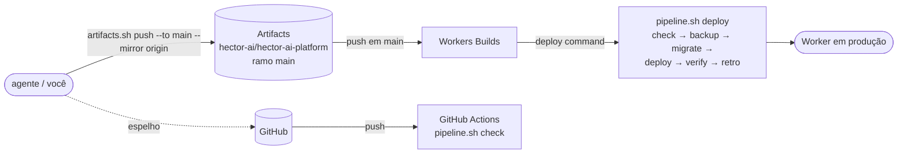

# Artifacts como casa do pipeline; GitHub como espelho

O repositório principal do projeto vive no **Cloudflare Artifacts** — Git dentro da própria conta Cloudflare, a mesma onde o site roda. O **Workers Builds** (o CI/CD da Cloudflare) dispara a cada push e executa os comandos desta skill. O **GitHub** recebe o mesmo código como espelho e roda os mesmos checks de forma independente.

Fontes (lidas em 13/11/2026): `developers.cloudflare.com/artifacts/` (git-protocol, wrangler, pricing, build-and-deploy-on-push) e `developers.cloudflare.com/workers/ci-cd/builds/` (artifacts-integration, configuration, api-reference, build-image). O Artifacts está em **beta aberto**; reler antes de mudar o desenho.

## O desenho



Nenhum Worker de CI próprio. O que é nosso continua sendo só o `pipeline.sh`; quem o chama muda.

| Peça | Papel | É nosso? |
|---|---|---|
| Artifacts | Repositório principal (Git) | Não — produto Cloudflare |
| Workers Builds | Dispara no push e roda os comandos | Não — produto Cloudflare |
| `pipeline.sh` | Os comandos: checks e deploy | Sim — a cola |
| GitHub | Espelho do código; segunda execução independente dos checks; workflow de deploy manual como reserva | Espelho |

## Comandos

```bash
scripts/artifacts.sh setup                            # cria o repositório e registra o remote "artifacts"
scripts/artifacts.sh push --to main --mirror origin   # envia ao Artifacts e espelha no GitHub
scripts/artifacts.sh push                             # envia o ramo atual (sem tocar em main)
scripts/artifacts.sh status                           # repositório, ramos, HEAD local enviado?
```

**Depois que o Workers Builds estiver conectado, `push --to main` publica em produção.** É o gesto de deploy.

O token do Artifacts é emitido a cada push (`wrangler artifacts repos issue-token`, 15 minutos) e passado ao git por cabeçalho. Não fica na URL do remote, em arquivo nem em log.

## Ordem de implantação

1. `artifacts.sh setup` e `artifacts.sh push --to main` — o Artifacts recebe o código. *(Feito em 13/11/2026.)*
2. **Primeiro deploy** por `pipeline.sh deploy` (local ou pelo workflow do GitHub). O Workers Builds só se conecta a um Worker que já existe.
3. 👤 **Conectar o Workers Builds** — no painel, uma vez (abaixo).
4. Dali em diante, deploy = `artifacts.sh push --to main --mirror origin`.

## 👤 Conectar o Workers Builds (painel, uma vez)

*Workers & Pages → o Worker → Settings → Builds → Connect.*

| Campo | Valor |
|---|---|
| Git connection | o namespace do Artifacts (`hector-ai`) |
| Repository | `hector-ai-platform` |
| Build command | *(vazio — o Builds instala as dependências sozinho)* |
| Deploy command | `skills/emdash-cicd/scripts/pipeline.sh deploy` |
| Preview command | deixar o padrão; **manter "Builds for Preview branches" desligado** |
| API token | um token **seu** com D1 Edit — ver nota |
| Build variables | `CLOUDFLARE_ACCOUNT_ID`, `EMDASH_TARGET_FINGERPRINT`, `EMDASH_DEPLOY_URL`; como secret, `EMDASH_CICD_ENCRYPTION_KEY` |

Notas:

- **O token gerado automaticamente pelo Builds não serve.** Ele traz Workers Scripts, KV, R2 e Workers Routes, mas **não D1**. O nosso deploy grava o bookmark do Time Travel e roda `emdash migrate`, que exigem D1 Edit. Usar um token próprio com: Workers Scripts, D1, Workers R2 Storage, Workers KV Storage (Edit), Workers Routes (Edit, na zona do domínio) e Artifacts.
- **Só `main` é ramo de produção** na integração com o Artifacts.
- **Previews ficam desligados** até a decisão D10. Num site EmDash, previews compartilham por padrão o banco de produção, aplicam migrations na primeira requisição e expõem o assistente de setup numa URL pública (doc EmDash: `deployment/cloudflare.mdx`, "Worker Previews").
- A conexão por API existe (`POST /accounts/{id}/builds/workers`), mas exige token **de usuário** com "Workers Builds Configuration: Edit", e a referência só documenta o provedor GitHub. Por isso este passo é do painel.

## O que ainda não foi verificado

- Um build real do Workers Builds a partir do Artifacts rodando `pipeline.sh deploy`. Pontos a observar no primeiro: se o checkout do build é um repositório git (o `deploy.sh` confere árvore limpa e grava o commit), se a versão do pnpm vem do `packageManager` do `package.json`, e se as build variables chegam como variáveis de ambiente ao deploy command.
- Onde ficam as evidências de um deploy feito pelo Builds. O log fica no Builds por 90 dias; o `backups/` e o run record são gerados dentro do build e se perdem com ele. Destino proposto: um ramo de registro no próprio Artifacts, espelhado no GitHub. **Ainda não implementado.**
- Custos reais. Artifacts: 1 GB e 10 mil operações por mês incluídos; depois US$ 0,50/GB-mês e US$ 0,15 por mil operações. O Workers Builds tem limites e preço próprios (`workers/ci-cd/builds/limits-and-pricing`), não lidos.

## Por que não o CI Workflow (`@cloudflare/ci`)

A Cloudflare oferece também um pipeline sob medida: um Worker com Workflows, Containers, Durable Object e R2 de cache, disparado pelo evento `cf.artifacts.repo.pushed`, com passos em paralelo e cache de dependências. É mais poderoso — e é um Worker de infraestrutura a mais para escrever, pagar e manter, com SDK ainda em evolução. Para um site só, o Workers Builds faz o mesmo com zero código nosso. Fica registrado como caminho de crescimento: se um dia houver muitos repositórios no namespace (um por coisa cadastrada), um único CI Workflow serve a todos.
